# FINN

**Live: [finn-ochre-five.vercel.app](https://finn-ochre-five.vercel.app)** (open on a phone; installable as a PWA)

**A brief you finish, graded against management's own words.**

FINN is a web-first investment agent built for the ENAM AI Engineer Build Challenge. It is designed for a portfolio manager at a lean, concentrated fund who owns 15 to 20 Indian listed companies and protects one thing: the reason they own each of them.

NSE alone publishes roughly 900 to 1,500 announcements a trading day, most of them paperwork. Reading one results filing and its call properly takes 30 to 60 minutes, and management promises are usually tracked from memory. FINN's job is to end the daily monitoring work in about two minutes, and to grade management rather than summarise it.

## An investor's day

A portfolio manager with 15 to 20 Indian names opens the brief before the market. Filings that need a decision come one at a time. On a results item, the quarter just reported sits next to the band management guided on an earlier call, and the manager records whether that changes the reason they own the company. The company page keeps that decision, the promise ledger, and the watchpoints taken from the call. A name that is not in the book is asked in the same place: FINN fetches the recent call, shows each step, and answers with the passage it used.

## Visual tour

### The brief

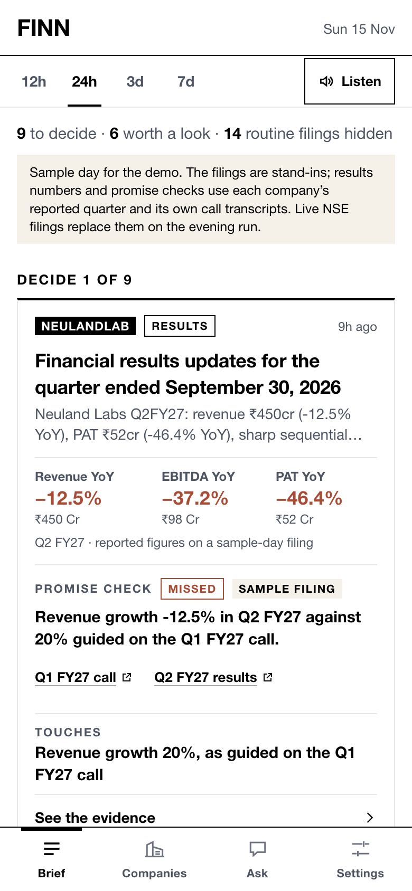

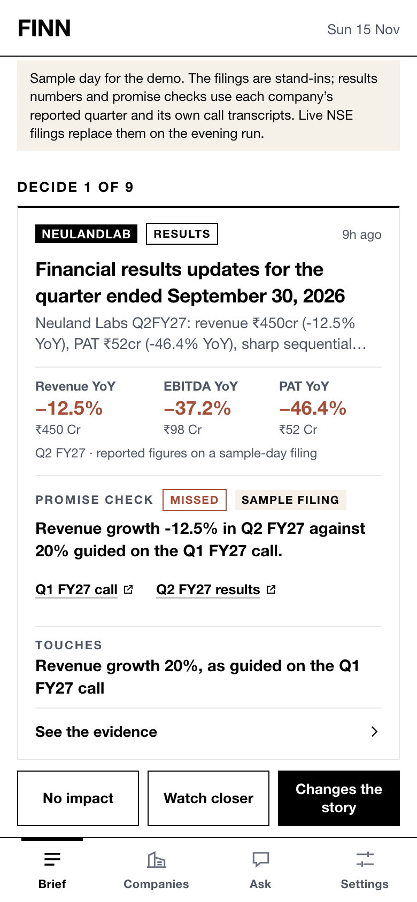

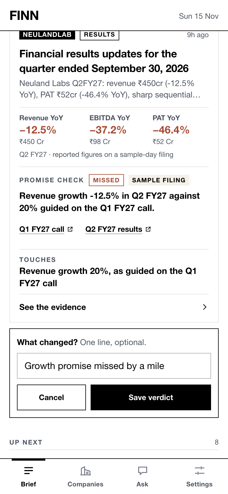

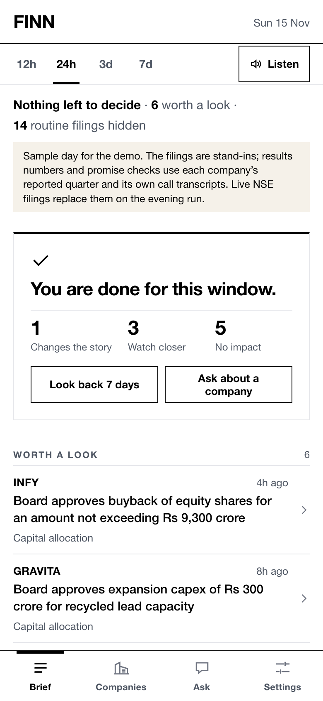

### The promise and the company

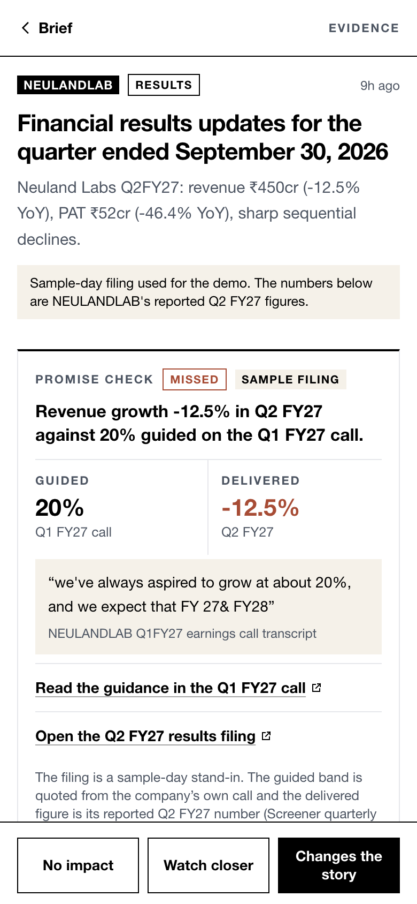

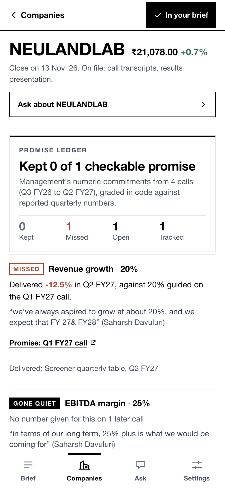

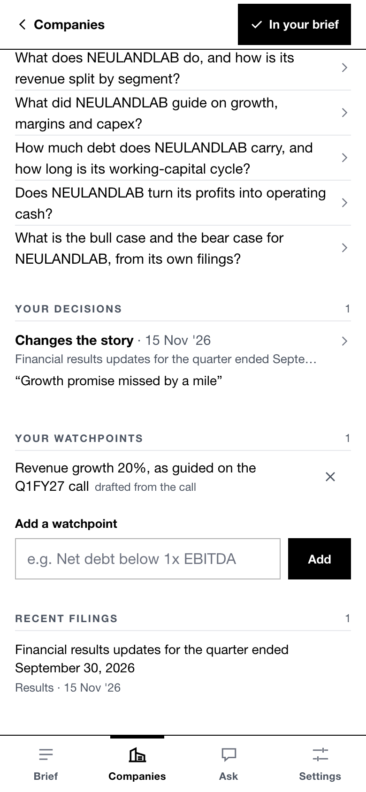

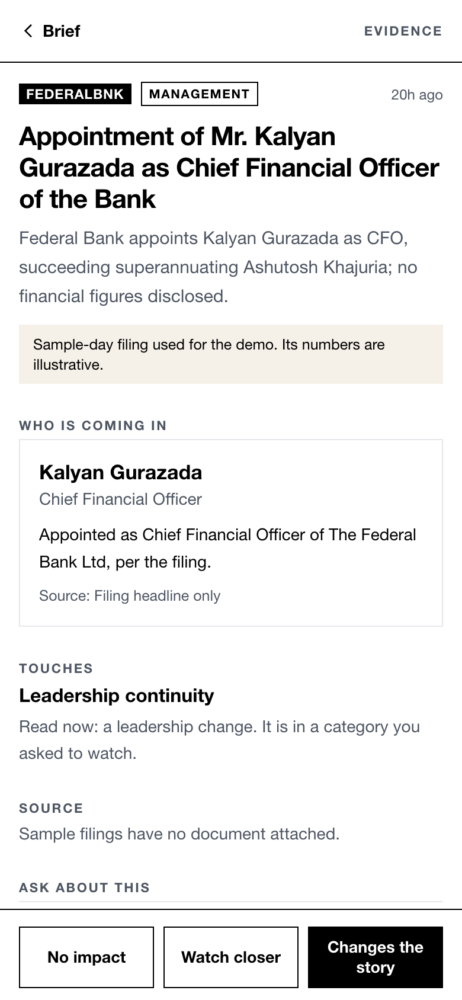

### A company that is not in the book

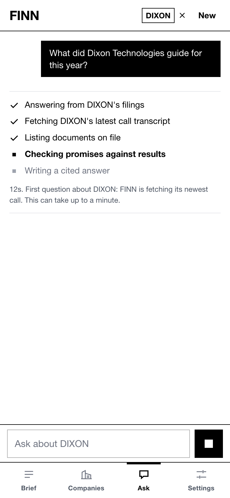

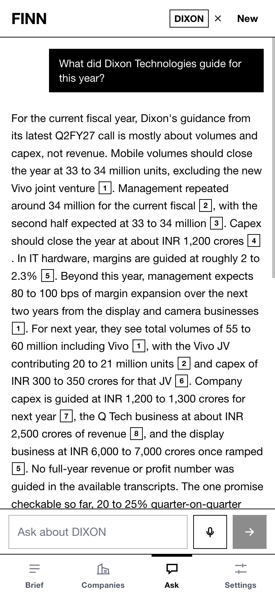

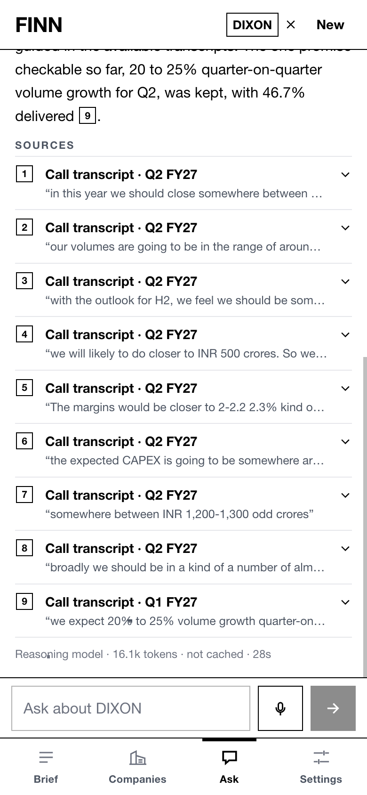

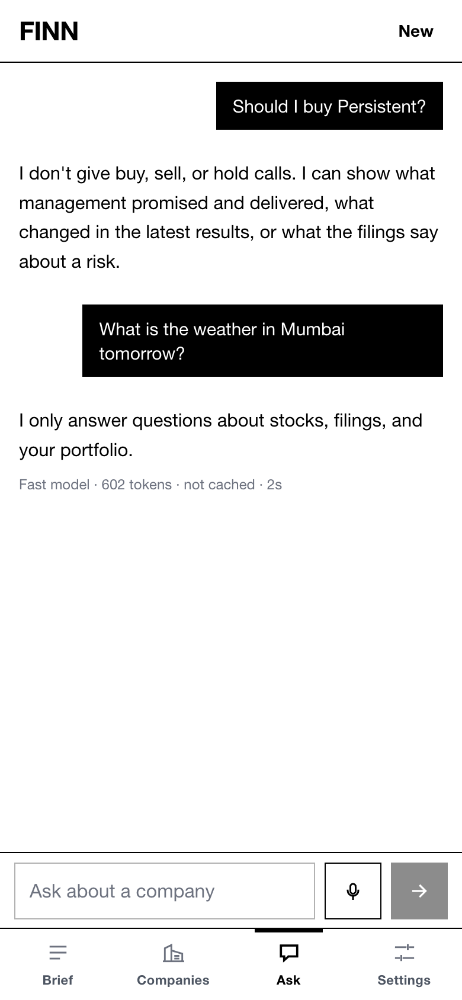

### Settings, and the same page on a wide screen

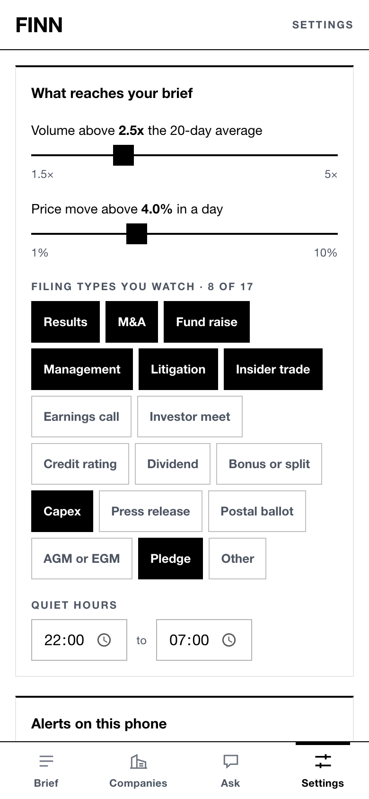

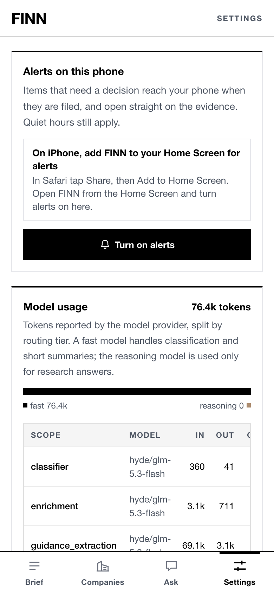

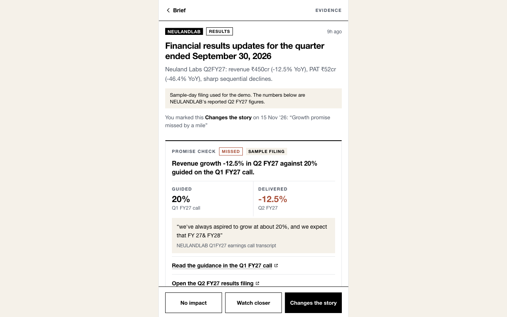

## Three-step tour

1. **Finish the Brief and record verdicts.** The home screen (`/`) shows only items that need a decision, one at a time, with routine filings counted rather than shown. Each item names the watchpoint it touches, recalls your past verdict on similar filings, and ends with "You are done for this window" once decided. Verdicts (`No impact`, `Watch closer`, `Changes the story`) and optional one-line reasons are saved to a decision journal.
2. **Promise Check on results alerts and Promise Ledger on company pages.** Results cards show Revenue, EBITDA, and PAT YoY inline alongside a code-computed **PromiseCheck** (`kept`, `missed`, `in_band`, or `no_guidance`) comparing reported numbers against the guidance band from management's own prior call. Tapping through to `/alert/[id]` or `/company/[ticker]` shows both citations side by side, plus the full Promise ledger and your decision history.
3. **Unseen NSE/BSE ticker on demand.** Ask about or open any NSE/BSE ticker FINN has never seen. It pulls live quarterly numbers, finds the newest call transcripts (or the latest annual report when the company holds no calls, such as ITC), indexes them with progress steps, and answers only from primary-source passages verified on the server. If no primary documents exist, it says so plainly.

## What else it does

- **Evidence (`/alert/[id]`)**: first-cut numbers with provenance, executive backgrounds extracted from the SEBI LODR filing itself, ranking reasons, and suggested questions that open `/chat`.
- **Listen**: reads the spoken brief (`en-IN`) via `window.speechSynthesis` when supported by the browser.
- **Web push**: PWA notifications deep-link to `/alert/[id]`. On iOS 16.4+, web push requires **Add to Home Screen** in Safari.
- **Guardrails**: off-topic questions, buy/sell/hold requests, and prompt-injection attempts are answered in one sentence before any model runs.

## Clients

- **Next.js PWA (`frontend/`)**: the primary deliverable, deployed on Vercel and backed by Render. No install required; mobile-first shell with bottom tabs (`Brief`, `Companies`, `Ask`, `Settings`).
- **Expo app (`mobile/`)**: an additional native client kept in the repo, speaking the same REST and SSE contract.

## Quick start

```bash
# Backend (Python 3.12+, uv)
cd backend
uv sync
cp .env.example .env            # set HYDE_API_KEY (OpenAI-compatible gateway)
uv run python -m finn.ingest.official_docs
uv run uvicorn finn.api.main:app --host 0.0.0.0 --port 8000

# Web app (Node 20+)
cd ../frontend && npm install
FINN_BACKEND_URL=http://localhost:8000 npm run dev
```

Open `http://localhost:3000`. In **Settings → Load the sample day**, fill the brief with a labelled sample of portfolio filings. Live NSE filings are fetched on the evening run (18:30 IST, Monday to Friday) and are never mixed with the sample.

## Architecture in one paragraph

FastAPI on SQLite (WAL, FTS5).

Push side: NSE announcements (read as India time) and yfinance end-of-day prices feed a keyword-first classifier. A deterministic ranking engine (category, headline wording, the investor's settings) and enrichers follow: results first cut and `promise_check` in code, executive profile from the filing. Stable identities mean reruns refresh alerts instead of duplicating them, and the brief is composed from stored alerts for any window.

Pull side: routing is decided in code. Company questions go to the research analyst (Google ADK) with tools for passage search, reported numbers, price context, and the Promise ledger. The server validates citations, holds back uncited answers, and caches answers until that company's documents or numbers change.

See [docs/ARCHITECTURE.md](docs/ARCHITECTURE.md), [docs/DECISIONS.md](docs/DECISIONS.md), and [DEPLOY.md](DEPLOY.md).

## Model routing and cost

One gateway model is available on this key (`hyde/glm-5.3-flash`, a thinking model), so the tiers differ by how much the model is allowed to think:

| Tier | Setting | Used for |
|---|---|---|
| Fast | `reasoning_effort=low` | classification of ambiguous filings, guidance extraction, executive profiles, one-line summaries, the portfolio assistant, writing the final answer from the analyst's notes |
| Reasoning | full reasoning | research synthesis only |
| None | code | all numbers, promise checks, ranking, verdict grading, routing, citation checks |

On the same three bulk jobs, the fast tier used 68 output tokens against 607 for full reasoning, with the same answers (`backend/evals/routing_bench.py`). Either tier can point at a different model through `FINN_MODEL_FAST` and `FINN_MODEL_REASONING`. Optional `FINN_PRICE_<TIER>_IN` and `FINN_PRICE_<TIER>_OUT` env vars compute per-answer cost; when unset, cost is omitted rather than guessed.

Caching:
- Each transcript's guidance is extracted once, keyed by document and extractor version.
- Research answers are reused at 0 tokens until new documents or numbers arrive for that company.
- Chat answers show their tier, token count, cost (when priced), and cache state.

## Tests and evals

```bash
cd backend && uv run pytest -q                     # deterministic backend tests
PYTHONPATH=. uv run python evals/run_chat_evals.py  # end-to-end through the live chat endpoint
PYTHONPATH=. uv run python evals/routing_bench.py   # fast versus reasoning tier on the same jobs
```

The chat evals run seven cases through the real endpoint: a grounded promise question, an unseen ticker, an out-of-corpus question, an advice request, an off-topic question, a prompt injection, and a portfolio question. The latest result (7 of 7) is in `backend/evals/results/latest.json`.
