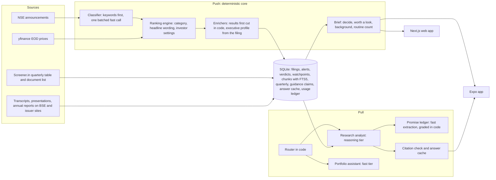

# FINN architecture

## The system at a glance

## Push: the brief

1. **Ingest.** `pipeline.run_pipeline` fetches NSE announcements for the watched tickers. That means the portfolio plus anything the investor added with Watch on a company page.
   - Times are read as India time.
   - A quiet live day returns nothing. An outage returns nothing too and is logged as an outage. The labelled sample day is loaded only when asked for, through Settings or `POST /api/demo/run`.
2. **Classify.** Keywords cover most of the taxonomy at zero model tokens. The ambiguous remainder goes to the fast tier in one batched call.
3. **Rank.** `alerts/engine.announcement_priority` combines a base tier per category with headline wording, then applies the investor's category watchlist: unwatched categories drop a tier. The rules include:
   - reaffirmed ratings, commercial paper, pledge releases and meeting intimations rank lower
   - order wins and buybacks rank higher
   - ESOP allotments, compliance certificates and shareholding patterns are routine

   Every stored alert is re-ranked when settings change. Each alert carries a plain reason ("Read now: a leadership change. It is in a category you asked to watch.").
4. **Enrich, material items only.**
   - Results: a deterministic first cut (Revenue, EBITDA, PBT, PAT, QoQ, YoY).
   - Management change: the incoming person's profile, read from the filing attachment, which must contain a brief profile under SEBI LODR. The annual report is the fallback. A background is accepted only if its supporting quote appears in the document.
   - Other material categories: a one-line summary that must pass a sentence check, or the headline.
5. **Store.** Alerts have a stable identity. Reruns refresh the event time rather than inserting copies, and keep the read state and any verdict.
6. **Brief.** `brief.brief(hours)` splits the window into items to decide (priority 1), worth a look (priority 2), background (priority 3) and a routine count. Each item carries:
   - the watchpoint it touches
   - whether it is new since the last look
   - the investor's last verdict on a similar item
7. **Push.** The single most important new item is sent through Expo push. It deep-links to `/alert/{id}`, and the body carries the first-cut numbers.

## Pull: routing, research, and citations

- **Routing in code** (`llm/intent.py`). A question that names a company (by symbol or common name), carries a ticker, or follows up on one goes to the research analyst. Portfolio-wide questions go to the fast assistant, which has only prices and the alert feed. The assistant cannot answer company analysis from memory because it never receives those questions.
- **Guards before any model** (`llm/chat_guard.py`). Off-topic questions and prompt-injection attempts get a one-sentence refusal. Buy, sell, or hold questions get a plain explanation of what FINN does instead.
- **Research analyst** (Google ADK `LlmAgent`, reasoning tier). Its tools are passage search (FTS5 with BM25), reported quarterly numbers, price context, a document overview, and the Promise ledger. Every tool result carries `source_id`s.
- **Citation check** (`llm/citations.py`). The server records every source a tool returned during the turn. Citations whose IDs were not returned are removed, the rest are renumbered `[1]`, `[2]`, and the client receives structured source records (title, period, URL, excerpt). A research answer with no valid citation is held back, unless it is the honest "not covered" reply.
- **Clean replies** (`llm/answer.py`). The thinking model sometimes writes its working into the reply. If the analyst does not return a tagged answer, the fast tier rewrites its notes into a short reply, keeping the citation markers. Citations are validated after that rewrite.
- **Answer cache.** A standalone company question is cached under the ticker, the normalised question, and a corpus version (chunk count, latest chunk ID, latest quarter). It is reused at 0 tokens until new documents or numbers arrive.

## Any ticker

`ingest/discovery.py` reads the company's Screener page:
- quarterly numbers, including depreciation, so EBIT margin can be checked
- the list of earnings calls with transcript and presentation links
- annual reports

Each call month maps to the quarter it discusses (an October 2026 call discusses Q2 FY27). The newest transcripts and the latest presentation are downloaded from BSE or the issuer and indexed, within a time budget. A company that holds no calls gets its latest annual report instead.

- The company page triggers this in the background and shows progress.
- A chat question about an unseen company triggers it inline before answering.

Live quarterly numbers replace any illustrative rows, so the two never mix in one series.

## The Promise ledger

`tools/ledger.py`.

**Extraction**, once per transcript and extractor version:
- Passages with guidance language and numbers are sent to the fast tier, which returns commitments.
- A commitment is kept only if the first words of its quote appear in the cited passage. Analyst questions are rejected.

**Grading**, in code:
- Revenue growth, EBITDA margin, EBIT margin and net margin are compared with the latest reported quarter after the call: kept or missed.
- A different band for the same metric and unit on a later call marks the earlier one revised.
- A metric with no number on later calls is gone quiet.
- Promises for the current quarter are too early.
- Absolute targets (revenue of $5 billion by FY31) are listed as stated targets to track.

Watchpoints are drafted from checkable promises the first time a company's ledger is built, and the investor can edit them.

## Model routing

| Tier | Model and setting | Jobs |
|---|---|---|
| Fast | `hyde/glm-5.3-flash`, `reasoning_effort=low` | ambiguous classification, guidance extraction, executive profiles, one-liners, portfolio assistant, final answer writing |
| Reasoning | `hyde/glm-5.3-flash`, full reasoning | research synthesis |
| Code | none | numbers, ranking, grading, routing, citation checks |

The gateway key permits one model, so the tiers differ by reasoning budget. On the same three bulk jobs the fast tier used 68 output tokens against 607 at full reasoning, with the same answers (`evals/routing_bench.py`). Changing either tier's model is one environment variable. Every call is logged with scope, tier, and tokens (`cost_ledger`), and each answer card shows its tier and token count.

## Data provenance

- Every number in the app is labelled: Screener quarterly table (compiled from exchange filings), the company's results presentation, or sample-day numbers for the demo.
- Sample-day alerts are flagged `is_sample` and shown with a label.
- Bios show their source and open the filing when one exists.

## Scheduling

APScheduler runs the live pipeline at 18:30 IST, Monday to Friday. `POST /api/demo/run` loads the sample day on demand.
