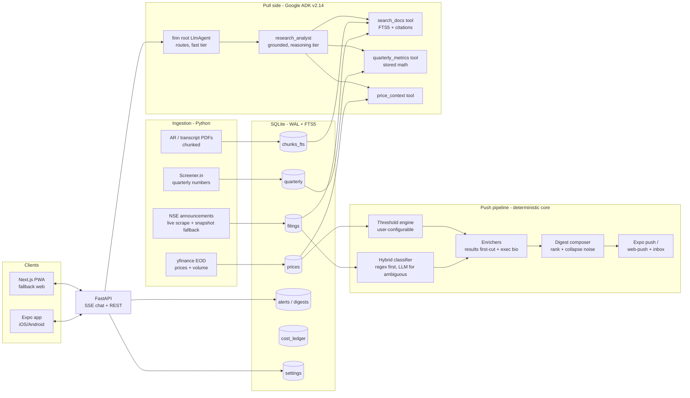

# FINN — Architecture

## The system at a glance

## Design principles (and why)

### 1. The LLM never does math
Every number shown — QoQ/YoY deltas, margins, volume ratios — is computed in pure
Python from stored data (`finn/tools/metrics.py`, `finn/alerts/engine.py`). The model
narrates; it never calculates. This kills a whole class of confident-wrong-number
failures, and it makes the deterministic tests (`tests/test_metrics.py`,
`tests/test_engine.py`) meaningful: if the threshold math is wrong, a test fails —
no probabilistic excuses.

### 2. Keywords first, LLM only for ambiguity
~80% of filings classify with regex over the 17-category taxonomy at zero cost.
Ambiguous ones go to the fast tier **in one batched call** (one request for all
pending items, not one per filing). This is the "smart model routing" instinct the
brief asks for, applied at the pipeline level.

### 3. Grounded-or-refuse on the Pull side
The ResearchAnalyst's system contract (see
`backend/finn/agents/research_analyst.py`) forbids outside knowledge: tools return a
`status: "no_results"` payload that *tells the model to say so*, and the eval suite
(`backend/evals/`) asserts both behaviours — citing `[S#]` for grounded claims and
explicit refusal outside the corpus. Every tool result carries doc_title + period +
URL so citations resolve to real documents.

### 4. "Unusual" belongs to the user
The threshold engine reads its parameters from the settings table, edited live in the
client (volume multiplier, price-move %, category watchlist, quiet hours). The engine
also emits a `why` string per alert — "Why am I seeing this?" is a first-class UI
disclosure, not a debug field.

### 5. Noise is counted, not shown
The digest composer ranks by (priority, recency), surfaces the top 12, and reports
routine paperwork as a number ("6 routine collapsed") — surfacing *that it was
filtered* is the trust mechanism; hiding silently is how apps lose investors.

### 6. Cost as a product surface
Every LLM call (classifier batch, one-liners, research turns) logs prompt/completion
tokens to `cost_ledger` with its pipeline scope. The Settings cost dashboard renders
the fast/reasoning split. When the reasoning tier is set to a stronger model, the
ledger visibly shows the analysis premium — the trade-off is measurable, not rhetorical.

## Model routing

| Tier | Default model | Used for |
|---|---|---|
| Fast | `hyde/glm-5.3-flash` | classification (batched), digest one-liners, exec-bio extraction, root-agent chat |
| Reasoning | `FINN_MODEL_REASONING` env (swap without code changes) | ResearchAnalyst synthesis: narrative-vs-numbers, bull/bear |

The Hyde gateway exposes one permitted model today, so both tiers resolve to the same
model by default; the separation is kept in config + ledger so a stronger reasoning
model (e.g. kimi-k3 when the key allows, Gemini, GPT) drops in via env var. Tiering
was validated end-to-end earlier in the build with a real second model.

## Data sources & fallbacks

- **NSE announcements**: live scrape first (session-warmed public API); a bundled
  snapshot of 39 realistic filings re-dated at load time so the demo is deterministic
  and never dies on a blocked IP.
- **Prices**: yfinance `.NS` with `.BO` fallback, 60 days, stored per EOD bar.
- **Quarterly numbers**: Screener.in scrape first; bundled 7-quarter snapshot for 7
  demo companies.
- **Documents**: Screener/manifest-driven PDF ingestion (pypdf, paragraph-aware
  chunking with overlap, repeated-header stripping) + seeded transcripts for hero
  companies. The corpus generalizes: `seed_docs.py` / `docs.py` ingest any ticker.

## ADK specifics (v2.14)

- Root `LlmAgent(name="finn")` with two sub-agents; delegation is ADK's native
  `transfer_to_agent` flow (visible in the UI as a tool chip).
- `LiteLlm` wrapper routes to any OpenAI-compatible gateway; env-var credentials set
  once in `llm/routing.ensure_llm_env()`.
- `DatabaseSessionService` on `sqlite+aiosqlite` persists conversations across app
  restarts; `InMemorySessionService` in evals.
- The chat endpoint streams `Runner.run_async` events over SSE; `is_final_response()`
  separates reasoning-preamble frames (rendered as dim "process" text) from the final
  answer — the thinking-model behavior is turned into visible agent process.

## Scheduling

APScheduler cron `18:30 IST Mon–Fri` runs one `run_pipeline()` pass: ingest → classify
→ enrich → thresholds → digest → push. The same function is exposed as `POST
/api/demo/run` so graders trigger a full cycle on demand instead of waiting for 18:30.
